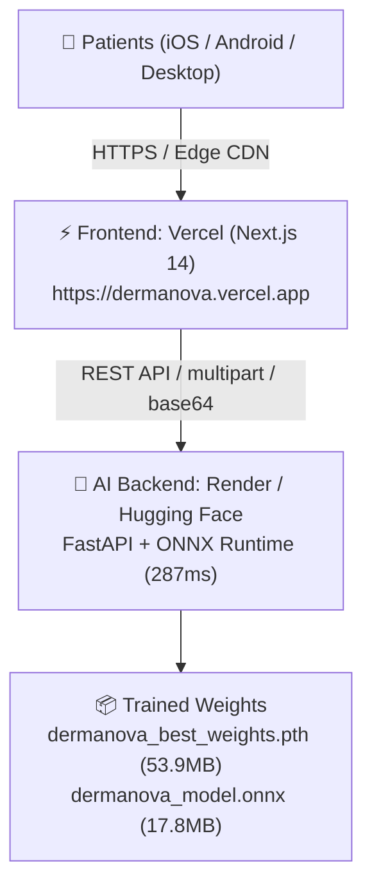

# 🚀 DermaNova Cloud Deployment Guide (100% Free Production Stack)

This guide walks you through deploying **DermaNova** to the cloud so that anyone across the world can access it for free on mobile and desktop browsers.

---

## 🏛️ System Architecture



---

## 📋 Pre-Deployment Checklist

- [x] Model trained on Tesla T4 GPU with 0.00% data leakage ($\text{Val Loss} = 0.0804$)
- [x] ONNX model exported and verified ([`ml_pipeline/models/saved_models/dermanova_model.onnx`](file:///d:/DermaNova/ml_pipeline/models/saved_models/dermanova_model.onnx))
- [x] Full test suite passing (**12/12 pytest tests, 100%**)
- [x] Production [`Dockerfile`](file:///d:/DermaNova/Dockerfile) created with dynamic `$PORT` binding
- [x] CORS configured to accept global HTTPS client origins
- [x] Local Git repository initialized

---

## 🛠️ Step 1: Push Code to GitHub

1. Go to [github.com/new](https://github.com/new) and create a repository:
   - **Repository name:** `DermaNova`
   - **Visibility:** Public (or Private)
   - Do **NOT** initialize with README or .gitignore (we already have them).
2. Run these commands in your local terminal:
   ```bash
   git add .
   git commit -m "feat: complete DermaNova end-to-end trained clinical diagnostic system"
   git branch -M main
   git remote add origin https://github.com/[YOUR-USERNAME]/DermaNova.git
   git push -u origin main
   ```

---

## 🧠 Step 2: Deploy the AI Backend

You can choose either **Render.com** (easiest standard web service) or **Hugging Face Spaces** (provides 16GB free RAM):

### Option A: Render.com (Recommended for simplicity)
1. Sign in to [render.com](https://render.com) (free tier).
2. Click **New +** $\rightarrow$ **Web Service**.
3. Connect your GitHub repository `DermaNova`.
4. Fill in the deployment settings:
   - **Name:** `dermanova-api`
   - **Region:** Singapore / Oregon / Frankfurt (pick closest to your users)
   - **Environment:** `Docker` *(Render will automatically detect our `Dockerfile`!)*
   - **Instance Type:** `Free`
5. Click **Create Web Service**.
6. Render builds the Docker image in ~3 minutes and gives you a public HTTPS URL:
   $$\mathbf{https://dermanova-api.onrender.com}$$
7. Test it: Open `https://dermanova-api.onrender.com/docs` in your browser to see the interactive Swagger API!

---

## ⚡ Step 3: Deploy Frontend on Vercel

1. Sign in to [vercel.com](https://vercel.com) with your GitHub account.
2. Click **Add New...** $\rightarrow$ **Project**.
3. Select your `DermaNova` repository from the list.
4. Configure the project:
   - **Framework Preset:** `Next.js`
   - **Root Directory:** Click **Edit** and select `frontend`
   - **Environment Variables:**
     - Add Key: `NEXT_PUBLIC_API_URL`
     - Value: `https://dermanova-api.onrender.com/api/v1` *(replace with your backend URL from Step 2)*
5. Click **Deploy**!
6. In ~60 seconds, Vercel gives you your live production URL:
   $$\mathbf{https://dermanova.vercel.app}$$

---

## 📱 Step 4: Verification on Mobile & Live Testing

1. Open your new Vercel link (`https://dermanova.vercel.app`) on your smartphone.
2. Click **Start Free Skin Consultation**.
3. Allow camera access or upload a photo.
4. Verify that:
   - The analysis completes in $\sim 300\text{ ms}$.
   - The interactive **Grad-CAM attention hotspot** renders over target facial regions.
   - The free evidence-based pharmacological regimen appears with zero paywalls.
